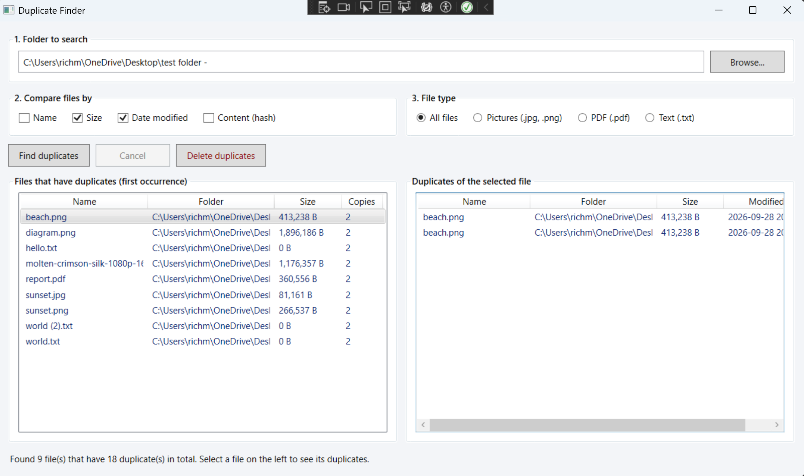
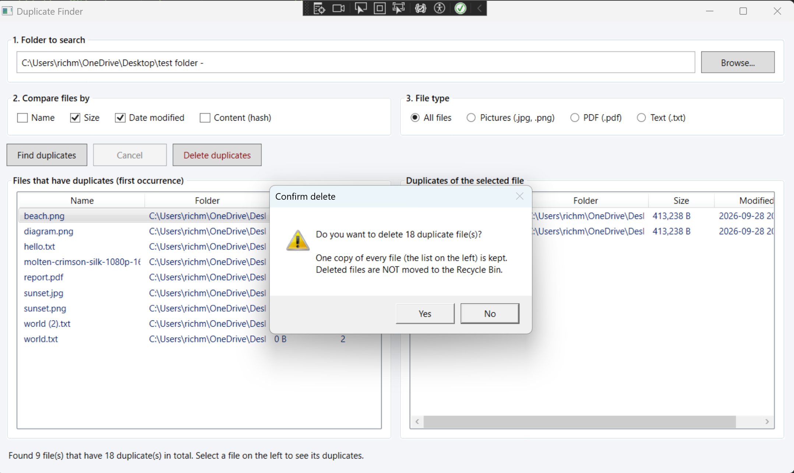

# Duplicate Finder –  Unit Testing

*Programming in C#, III – Malmö University*

A WPF desktop app that scans a folder (and all its subfolders) for duplicate files, shows them in two lists, and can delete the duplicates while keeping one copy of each file. The logic sits in one class, `DuplicateFinder`, which is tested by an **MSTest** project and an **xUnit** project.





## Solution structure

```
DuplicateFinder.sln
├── DuplicateFinderApp/            WPF application (.NET 10)
│   ├── MainWindow.xaml(.cs)       GUI: reads the user's choices, shows results
│   ├── DuplicateFinder.cs         All file logic (no GUI code), all async
│   ├── CompareSettings.cs         Which attributes to compare (Name, Size, Date, Hash)
│   ├── FileType.cs                All files, Pictures (.jpg/.png), PDF, Text
│   └── DuplicateGroup.cs          One original + its duplicates
├── DuplicateFinderTest/           MSTest project (23 tests)
├── DuplicateFinderXUnitTest/      xUnit project (20 test runs)
└── SampleFiles/                   Small files with known duplicates for manual testing
```

## How it works

`FindDuplicatesAsync` is the method the window calls (with `await`). It runs four small steps, each in its own method:

1. **`GetFilesAsync`** – lists all files in the folder and its subfolders on a background thread, sorted by path.
2. **`FilterByFileTypeAsync`** – keeps only the selected file type (uses `GetExtensions`).
3. **`CreateKeyAsync`** – builds a key from the selected attributes, for example `52341|2025-01-15 10:30:00`. With *Content (hash)* the key includes a SHA-256 hash from **`ComputeHashAsync`**.
4. Files with the **same key** are duplicates. The first one (by path) is the original; the rest are its duplicates.

**`DeleteDuplicatesAsync`** deletes every duplicate and keeps the originals. The window always asks for confirmation first.

A search can be stopped with **Cancel**, which uses a `CancellationToken`.

##  requirements

| Requirement | Where |
|---|---|
|  – WPF GUI, `DuplicateFinder` class without GUI code | `MainWindow.xaml`, `DuplicateFinder.cs` |
|  – async search, called with `await` | `FindDuplicatesAsync`, `BtnFind_Click` |
|  – select a folder | `BtnBrowse_Click` (`OpenFolderDialog`) |
|  – 2 attributes and 2 file types, results shown in the GUI | Size, Date modified; Pictures, PDF |
|  – MSTest project, async tests with AAA | `DuplicateFinderTest` |
|  – 3 file types (all files, .jpg, .pdf) | `FileType`, radio buttons |
|  – smaller methods: collect files, filter by type | `GetFilesAsync`, `FilterByFileTypeAsync` |
|  – a test for another method than the main one | `GetFilesAsync_*`, `FilterByFileTypeAsync_*` |
|  – all attributes and file types (all, .jpg/.png, .pdf, .txt) | Name, Size, Date modified, Hash |
|  – as many async methods as possible | Every method except the tiny `GetExtensions` helper |
|  – two lists: first occurrences and duplicates | `lvOriginals`, `lvDuplicates` |
|  – delete all duplicates, with confirmation | `BtnDelete_Click`, `DeleteDuplicatesAsync` |
|  – unit tests for all methods | 23 MSTest tests cover all six public methods |
| – hash-based comparison | `ComputeHashAsync` (SHA-256, `HashAlgorithm.ComputeHashAsync`) |
| – xUnit project testing the same functionality | `DuplicateFinderXUnitTest` |
| Optional – Cancel button | `CancellationTokenSource` in `MainWindow`, token in every method |

## How to  Run it

1. Open `DuplicateFinder.sln` in Visual Studio 2026.
2. Set **DuplicateFinderApp** as startup project and press **F5**.
3. Click **Browse...** and select a **copy** of the `SampleFiles` folder you plan to use .

## Run the tests

**Test → Run All Tests**. Test Explorer should show **43 passed** tests (23 MSTest + 20 xUnit). Each test creates its own temporary folder under `%TEMP%` and deletes it afterwards, so no real files are touched.

## Sample files

`SampleFiles/` contains small files with known duplicates that I have created :

| Settings | Expected result |
|---|---|
| Size + Date modified, All files | 4 files with 5 duplicates. `hello.txt` and `world.txt` show up as duplicates because they have the same size and date, though the content differs. |
| Content (hash), All files | 4 files with 5 duplicates. `sunset.png` and `IMG_0042.png` are found though name and date differ; `hello.txt`/`world.txt` are **not** duplicates. |
| Size + Date modified, Pictures | 1 file (`beach.jpg`) with 2 duplicates |
| Name, All files | 2 files (`beach.jpg`, `report.pdf`) |

This shows why the hash is the most accurate comparison: it compares the contents, not the metadata.

>  **Delete duplicates** really deletes files (they don't go to the Recycle Bin). Copy `SampleFiles` to another place and test on the copy.


